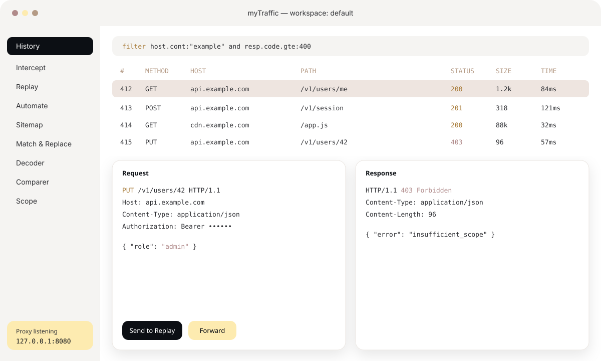

<p align="center">
  
</p>

<h1 align="center">myTraffic</h1>

<p align="center">
  A quiet, fast, local-first workbench for inspecting and replaying web traffic.<br>
  Free and open source. No signup, no servers, no paid tiers.
</p>

<p align="center">
  <a href="https://qub-official.github.io/myTraffic/">Website</a> ·
  <a href="https://github.com/qub-official/myTraffic/releases">Download</a> ·
  <a href="LICENSE">MIT License</a>
</p>

<p align="center">
  
</p>

---

## What it does

myTraffic is an intercepting HTTP/HTTPS proxy with a desktop web UI, a command
line, and a built-in MCP server. It records traffic from your browser or apps so
you can inspect, filter, edit and replay requests — the everyday workflow of
tools like Burp Suite and Caido, with every feature free.

| Area | What you get |
|------|--------------|
| **History** | Every request/response in a searchable, filterable table with a live feed. |
| **HTTPQL filter** | Full Caido-style query language: `req.host.cont:"api" AND resp.code.gte:400`, with namespaces (`req`/`resp`/`row`), operators (`eq ne gt gte lt lte cont ncont like nlike regex nregex`), `AND`/`OR` and parentheses. |
| **Intercept** | Pause matching requests, edit headers/body, then forward or drop. |
| **Replay** | Re-send any request, tweak it, and read the response side by side. |
| **Automate (Intruder)** | Fuzzing engine with all four attack types (Sniper, Battering ram, Pitchfork, Cluster bomb), payload sets (list, numbers, null, brute-force), grep-match, and concurrency — free and unthrottled. |
| **WebSockets** | Capture WebSocket frames both directions with a StreamQL filter (`ws.direction.eq:"client"`), live. |
| **Match & Replace** | Rewrite request/response headers and bodies with regex rules. |
| **Decoder** | base64, URL, hex, MD5, SHA-1, SHA-256 and JWT, in the UI or CLI. |
| **Comparer** | Line-level diff between two responses or payloads. |
| **Sequencer** | Token randomness analysis — Shannon entropy, per-position breakdown, verdict. |
| **Sitemap** | Host/path tree built automatically from captured traffic. |
| **Findings & annotations** | Record findings with severity; colour, note and star any request. |
| **Scope & upstream** | Limit capture to chosen hosts; chain through another proxy. |
| **Projects** | Save/load the whole session (flows, findings, rules, scope, presets) to a JSON file. |
| **Themes** | Light and dark, Korean-inspired palette. |
| **CLI** | `history`, `replay`, `automate`, `sequencer`, `project`, `decode`, `ca` — scriptable. |
| **MCP** | AI assistants can list, inspect, replay, fuzz, map and analyze traffic via the Model Context Protocol. |

See [ROADMAP.md](ROADMAP.md) for the full feature-by-feature comparison with Burp and Caido, and what's planned next.

Everything runs on `localhost`. No account, no cloud, no license check.

> **Use responsibly.** Only inspect traffic on systems and applications you own
> or are explicitly authorized to test.

## Install

Download the Windows installer from [Releases](https://github.com/qub-official/myTraffic/releases)
and run it. It installs `mytraffic.exe` and can add it to your `PATH` for the CLI
and MCP server.

## Quick start

1. Launch **myTraffic** (or run `mytraffic proxy`). The UI opens at
   `http://127.0.0.1:8081` and the proxy listens on `127.0.0.1:8080`.
2. Point your browser or system HTTP(S) proxy at `127.0.0.1:8080`.
3. For HTTPS, trust the root certificate once (see below).
4. Browse. Requests appear in **History** in real time.

### Trust the HTTPS certificate

myTraffic mints certificates on the fly, signed by a local root CA stored in
`%APPDATA%\myTraffic\ca`. To inspect HTTPS, trust that root once:

```powershell
# print the path to the certificate
mytraffic ca
# then import it into the Windows "Trusted Root Certification Authorities" store
certutil -user -addstore Root "$(mytraffic ca)"
```

Or click **CA cert** in the UI to download `myTraffic-ca.pem` and import it
manually. Firefox uses its own store (Settings → Certificates → Import).

## Command line

```bash
mytraffic proxy                          # run the proxy + UI (default command)
mytraffic history --filter 'resp.code.gte:400' --limit 20
mytraffic replay 412                     # replay captured flow #412
mytraffic automate --url 'https://host/user/§1§' --wordlist ids.txt --grep "admin"
mytraffic sequencer --file tokens.txt    # token randomness analysis
mytraffic project export session.json    # save the whole session
mytraffic project import session.json    # load it back
mytraffic decode base64decode aGVsbG8=   # -> hello
mytraffic ca                             # path to the root certificate
```

`history` and `replay` talk to a running instance over its local API
(`--api http://127.0.0.1:8081`).

## MCP (AI assistants)

Run `mytraffic proxy` first, then point your MCP client at the server. Example
client config:

```json
{
  "mcpServers": {
    "myTraffic": {
      "command": "mytraffic",
      "args": ["mcp", "--api", "http://127.0.0.1:8081"]
    }
  }
}
```

Tools exposed: `list_flows`, `get_flow`, `replay_flow`, `send_request`,
`decode`, `set_intercept`, `get_scope`, `sitemap`, `automate`, `list_ws`,
`sequencer`, `list_findings`, `add_finding`.

## Build from source

Requires [Go 1.21+](https://go.dev/dl/). Optional:
[Inno Setup](https://jrsoftware.org/isdl.php) for the installer.

```powershell
# from the repo root
powershell -ExecutionPolicy Bypass -File build.ps1
```

This produces `app\mytraffic.exe` and, if Inno Setup is installed,
`installer\Output\myTraffic-Setup-<version>.exe`. Or build by hand:

```bash
cd app
go build -trimpath -ldflags "-s -w" -o mytraffic.exe .
```

## Project layout

```
app/                 Go source (single static binary, stdlib only)
  internal/ca        on-the-fly TLS certificate authority
  internal/proxy     intercepting proxy, rules, intercept, replay, WebSockets, upstream
  internal/store     flow + WebSocket history, findings, presets (HTTPQL-filtered)
  internal/httpql    HTTPQL / StreamQL query language (parser + evaluator)
  internal/automate  fuzzing engine (Intruder/Automate)
  internal/toolkit   encode/decode/hash + diff + sequencer helpers
  internal/api       local JSON API + server-sent events
  internal/mcp       MCP server (stdio, JSON-RPC 2.0)
  web/               embedded web UI (vanilla JS)
installer/           Inno Setup script
index.html, assets/  project website (GitHub Pages)
```

## License

[MIT](LICENSE) © qub-official
